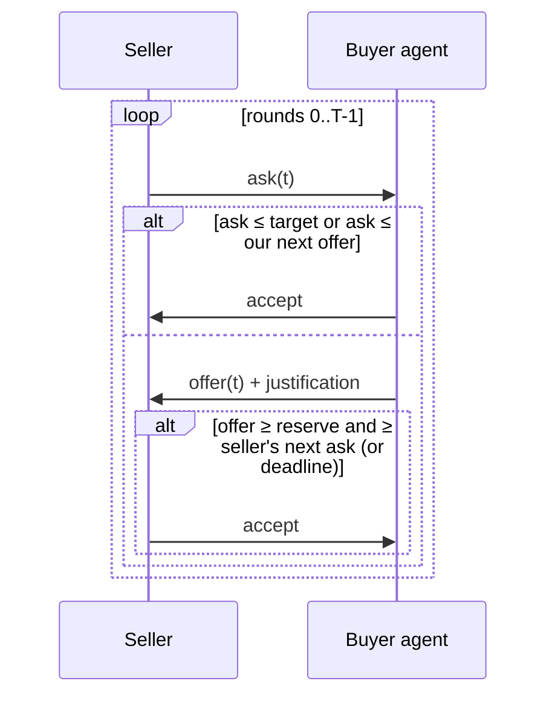

# Architecture — haggle-agent

## 1. Scope
The negotiation brain for a buyer agent: strategy, offers, acceptance, messaging, and a simulator.
**MVP:** brief (list, target, walk-away, rounds, leverage), time-dependent concession strategies
(Boulware, linear, conceder) plus tit-for-tat, anchoring, AC-next acceptance, justification
messages, seller simulator with hidden reserve, tournament.
**Product:** channel adapters (email, marketplace chat, seller bots), learned seller models, guardrails.

## 2. Negotiation loop

## 3. Strategy math
Offer(t) = `opening + (walkaway − opening) · t^(1/e)`, with `t ∈ [0,1]`. `e < 1` is Boulware
(holds firm, concedes late), `e = 1` is linear, and `e > 1` is a conceder. Offers are monotonic
(never retreat) and capped at the walk-away. Opening anchor = `max(target − 0.5·(list − target), 0.75·target)`.
Tit-for-tat mirrors the seller's last concession.

## 4. Design decisions
- **The walk-away is a hard constraint enforced in code,** never in prompts. The LLM in the product
  writes *messages*, while the engine decides *numbers*.
- **AC-next acceptance** (accept if the ask is ≤ what we'd offer next) is a well-known rule from the
  automated negotiation literature (ANAC). It avoids leaving deals on the table at the deadline.
- **A simulator and tournament ship with the engine.** Strategies are evaluated against seller
  populations before touching real money.

## 5. Future production architecture (not shipped)
Not shipped in this release — the product ships the engine, simulator, and web API; the items
below are roadmap (see README Roadmap), not production architecture:
A negotiation session service (state per counterparty thread), channel adapters, an LLM message
layer constrained to the engine's price, and a verifiability guard: leverage claims must reference
stored evidence (competitor quote URL), otherwise they're blocked.

## 6. Risks
Deceptive tactics are explicitly out of scope, with no fabricated competitor quotes. Seller bots
may detect agents, which the product tracks per channel as acceptance rates.
